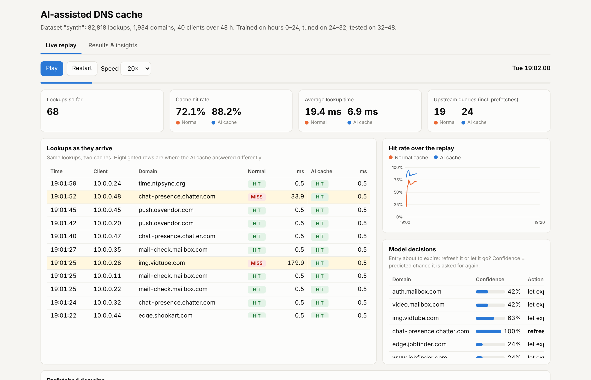
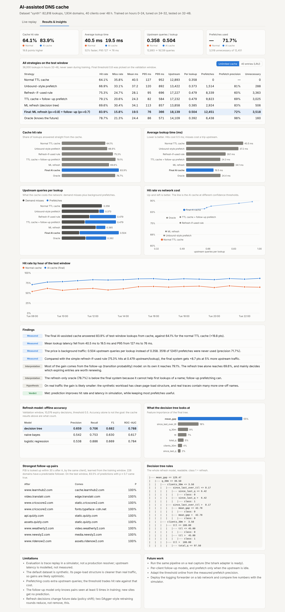
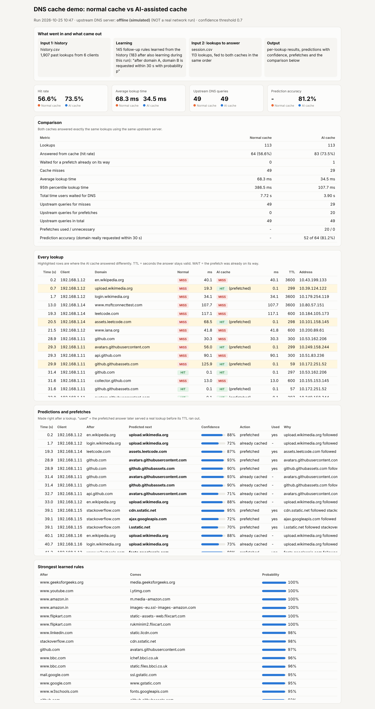

# AI-assisted DNS Cache Optimisation and Query Prediction

**Computer Networks project · Slot F1 · Team 28 (F1_Team28)**

A local DNS cache that logs every lookup, learns which domains are likely to
be asked for next, and **prefetches** them (respecting their TTL) so the answer
is already in the cache when it is needed. It is compared against a normal TTL
cache and several standard baselines on cache-hit ratio, lookup latency,
upstream traffic and unnecessary prefetches.

The prediction is deliberately simple and explainable: transition
probabilities for "which domain comes next" and a small decision tree for "is
this entry worth refreshing before it expires".



## Contents

* [Software requirements](#software-requirements)
* [Installation](#installation)
* [Execution steps](#execution-steps)
* [Expected results](#expected-results)
* [How it works](#how-it-works)
* [Testing](#testing)
* [Using a real dataset](#using-a-real-dataset)
* [Project layout](#project-layout)

## Software requirements

| | Version |
|---|---|
| OS | Windows 10/11, Linux or macOS |
| Python | 3.10 or newer |
| Python packages | `numpy`, `scikit-learn`, `pytest` (installed from `requirements.txt`) |
| Browser | any modern browser, to open the dashboard and demo report |
| Internet | only for the live demo with real DNS queries (it has an `--offline` mode) |
| Editor (optional) | Visual Studio Code |

No database or extra server is needed. Everything else uses the Python
standard library, including the DNS forwarder and the pcap reader.

## Installation

```bash
git clone https://github.com/chaitanyaghogare/dns-query-prediction.git
cd dns-query-prediction
python -m venv .venv
.venv\Scripts\activate          # Windows
# source .venv/bin/activate     # Linux / macOS
pip install -r requirements.txt
```

Optional: `pip install -e .` installs the `dnscache` package so its modules
can be run with `python -m dnscache....` from anywhere.

## Execution steps

**1. Run the whole experiment (about 1 minute):**

```bash
python run_all.py
```

This generates the synthetic DNS trace (`data/synth/`), trains the models
(`models/synth/`), replays the trace through every caching strategy, writes
the results (`experiments/results/synth/`) and rebuilds the dashboard.

**2. Open the dashboard:** open `dashboard/index.html` in a browser
(double-clicking it works, no server needed). The *Live replay* tab plays back
20 minutes of lookups through the normal and the AI cache side by side; the
*Results & insights* tab compares all strategies.

**3. Run the live demo with real DNS queries:**

```bash
python demo.py run
```

It learns from `demo/input/history.csv`, then answers a 10-minute browsing
session of real websites (`demo/input/session.csv`) with a normal cache and
the AI cache, printing every lookup and prediction. Outputs go to
`demo/output/` (`report.html`, `lookups.csv`, `predictions.csv`,
`summary.json`). Other modes: `python demo.py interactive` (type domains) and
`python demo.py serve` (a DNS server on port 5300 you can query with
`nslookup -port=5300 www.github.com 127.0.0.1`). If the network blocks DNS,
add `--offline`. Step-by-step presentation guide: [docs/DEMO.md](docs/DEMO.md).

**4. Run the tests:**

```bash
python -m pytest
```

## Expected results

`run_all.py` is seeded, so it reproduces these numbers exactly. Test window
of the synthetic trace (36,000 lookups the models never saw, unlimited cache):

| Strategy | Hit rate | Mean latency | P95 latency | Upstream per lookup | Prefetch precision |
|---|---|---|---|---|---|
| Normal TTL cache | 64.1% | 40.5 ms | 127 ms | 0.358 | — |
| Unbound-style prefetch | 66.9% | 37.2 ms | 120 ms | 0.373 | 81% |
| Refresh-if-used rule | 75.3% | 28.1 ms | 95 ms | 0.479 | 60% |
| TTL cache + follow-up prefetch | 79.1% | 24.3 ms | 82 ms | 0.479 | 69% |
| ML refresh (decision tree) | 69.6% | 34.1 ms | 113 ms | 0.385 | 83% |
| **Final AI cache: ML refresh + follow-up prefetch** | **83.9%** | **19.5 ms** | **76 ms** | **0.504** | **72%** |
| Oracle refresh (knows the future) | 78.7% | 24.4 ms | 86 ms | 0.392 | 98% |

* Hit rate rises from **64.1% to 83.9%** and mean lookup time falls from
  **40.5 to 19.5 ms**.
* The cost is about 40% more upstream queries; 72% of prefetches were used
  and 28% were unnecessary.
* The oracle only knows which *refreshes* pay off; it cannot help the first
  lookup of a domain, which follow-up prediction can. That is why the final
  system beats it.

The live demo (`python demo.py run --offline`) gives a hit rate of 56.6% for
the normal cache and 73.5% for the AI cache, with the same number of upstream
queries (49). On a real network the latencies differ from run to run.

**On real traffic** (the Thapar campus trace, test window Sun 21:54 → Mon
07:54, `python run_all.py --config configs/thapar.json`) the gain is smaller,
as expected:

| Strategy | Hit rate | Mean latency | P95 latency | Upstream per lookup | Prefetch precision |
|---|---|---|---|---|---|
| Normal TTL cache | 72.8% | 30.0 ms | 97 ms | 0.260 | — |
| Unbound-style prefetch | 73.8% | 29.0 ms | 95 ms | 0.266 | 78% |
| Refresh-if-used rule | 78.0% | 24.4 ms | 84 ms | 0.351 | 42% |
| ML refresh (decision tree) | 77.3% | 25.2 ms | 86 ms | 0.294 | 68% |
| **Final AI cache** | **78.4%** | **24.0 ms** | **83 ms** | **0.319** | **59%** |
| Oracle refresh | 80.1% | 22.3 ms | 79 ms | 0.274 | 96% |

On real data the final AI cache gains +5.6 points of hit rate and cuts mean
latency by 20%. It slightly beats the refresh-if-used rule while sending 9%
fewer upstream queries. Full numbers: `experiments/results/thapar/comparison.csv`.
These are from this rebuilt code; the original version reported 58.5% → 69.9%
on the same trace; the two versions differ in places (see
[docs/RECONSTRUCTION.md](docs/RECONSTRUCTION.md)).

| Dashboard results tab | Live demo report |
|---|---|
|  |  |

## How it works

Two paths, so the ML never slows down an ordinary lookup:

* **Fast path (every lookup, no ML).** Hit: answer from the cache. Miss: ask
  the upstream server, answer, store with the upstream TTL. Lookups that
  arrive while an answer is on its way wait for it ("in flight").
* **Slow path (in the background, where prediction lives).**
  1. **Follow-up prediction (transition probabilities).** After a lookup of
     domain A, every domain B with P(B within 30 s | A) ≥ 0.7 is prefetched if
     it is not already cached. P is `count(A then B) / count(A)` from the
     training window, so each prediction is explained by two numbers.
  2. **Refresh prediction (decision tree).** 2 s before an entry expires, a
     depth-5 decision tree predicts whether it will be asked for again within
     the next TTL. If its confidence is above the threshold, the entry is
     renewed in the background; otherwise it expires as normal.

Prefetched records get their real upstream TTL, so nothing is ever served past
its TTL.

**Evaluation** is trace replay in a discrete-event simulator, so every
strategy sees exactly the same lookups and the same network. The trace is
split by time: train on the first part, choose the threshold on the next, and
report only on the last part. Metrics: hit/miss/in-flight rates, miss types
(first-time, expired, evicted), mean/P50/P95/P99 latency, upstream queries
(demand + prefetch), prefetch precision, unnecessary prefetches and cache
occupancy. Model accuracy is reported too, but the cache numbers are the goal.

The full explanation is in [docs/PROJECT_EXPLANATION.md](docs/PROJECT_EXPLANATION.md).

## Testing

41 automated tests cover the cache and simulator, every policy, the data
adapters, the models, the DNS forwarder, the live demo and the full pipeline.
All pass. The full test log, the experiment results and the demo results are
in [docs/testing/F1_Team28_Test_Results.md](docs/testing/F1_Team28_Test_Results.md).

## Using a real dataset

Any DNS capture or query log can replace the synthetic trace. Raw data is
never committed: everything under `data/` is ignored by git.

### The Thapar campus trace

1. Download *10 Days DNS Network Traffic from April-May, 2016* (Thapar
   University) from Mendeley Data: <https://data.mendeley.com/datasets/zh3wnddzxy/2>
   (DOI 10.17632/zh3wnddzxy.2). Click **Download All**. It contains Day 0
   and part of Day 1 as hourly pcap files.
2. Unzip it and put the pcap files in `data/thapar/raw/` (subfolders are fine).
3. Run:

   ```bash
   python run_all.py --config configs/thapar.json
   ```

   The first run converts the pcaps (about 10 GB) once, which takes several
   minutes, into `data/thapar/trace.csv` and `data/thapar/catalogue.json`: a
   10% sample of clients, times in IST, and TTLs taken from the DNS
   responses. The campus resolver (`172.31.1.6`) is excluded, because its
   queries are not client demand. Later runs reuse these files; delete them
   to convert again. No Wireshark is needed.
4. Results go to `experiments/results/thapar/` and `models/thapar/`. The
   dashboard is rebuilt into `dashboard/index.html` (run `python run_all.py`
   again to get the synthetic one back). The train/validation/test windows in
   `configs/thapar.json` match the original project's split.

Only the aggregate Thapar results (`comparison.csv`) and the decision tree
are committed. Outputs that list individual lookups (`summary.json`,
`sequence.json`, the Thapar dashboard) are ignored by git, like the raw data.

### Any other capture or log

* **pcap / pcapng files:** copy `configs/thapar.json` to
  `configs/mytrace.json`, change `name` and `pcap_dir`, and run
  `python run_all.py --config configs/mytrace.json`.
* **A Wireshark/tshark export:** export the DNS queries to CSV,

  ```bash
  tshark -r capture.pcap -Y "dns.flags.response == 0" -T fields -E separator=, -E header=y \
      -e frame.time_epoch -e ip.src -e dns.qry.name -e dns.qry.type > data/mytrace/queries.csv
  ```

  and point `trace_csv` at it in your config.
* **Any other query log:** make a CSV with the columns `ts,client,qname` and
  optionally `qtype` (default `A`). `ts` is UNIX time or seconds from the
  start; `client` is any ID. The forwarder's own log (`data/live/queries.csv`,
  from `python -m dnscache.collect.forwarder --port 5300 --predict`) works too.
  Without TTL information every domain gets the default TTL of 300 s.

A config only lists what differs from `configs/default.json`. The time split
can be given as fractions of the trace:

```json
{
  "name": "mytrace",
  "trace_csv": "data/mytrace/queries.csv",
  "windows_frac": {"train": [0, 0.55], "validation": [0.55, 0.7], "test": [0.7, 1.0]},
  "replay_start_frac": 0.85
}
```

The training part needs several hours of traffic so that follow-up pairs
reach the minimum support of 5.

## Project layout

| Path | What |
|---|---|
| `run_all.py` | the whole experiment in one command |
| `demo.py` | live demo with real DNS queries |
| `requirements.txt`, `pyproject.toml` | dependencies and package metadata |
| `configs/` | experiment settings (`default.json` = synthetic run, `thapar.json` = Thapar trace) |
| `src/dnscache/data/` | trace schema, CSV I/O, quality check, adapters (canonical CSV, tshark, pcap) |
| `src/dnscache/synth/` | seeded synthetic workload generator |
| `src/dnscache/sim/` | cache (TTL + LRU), upstream model, discrete-event simulator, caching policies |
| `src/dnscache/predict/` | decision-time features, refresh models (decision tree, naive Bayes, logistic regression), follow-up model |
| `src/dnscache/collect/` | logging DNS forwarder, DNS wire-format helpers, test client |
| `src/dnscache/demo/` | live demo: real resolver, normal vs AI cache, HTML report |
| `src/dnscache/dashboard/` | dashboard builder and HTML template |
| `src/dnscache/run.py` | the pipeline behind `run_all.py` |
| `dashboard/index.html` | the built dashboard (synthetic run) |
| `models/synth/` | trained decision tree (`refresh_tree.pkl`, readable rules in `tree_rules.txt`) and follow-up model (`sequence.json`) |
| `experiments/results/synth/` | `comparison.csv`, `summary.json` |
| `experiments/results/thapar/`, `models/thapar/` | aggregate results and decision tree from the real Thapar trace |
| `demo/input/` | demo inputs (outputs go to `demo/output/`, not committed) |
| `tests/` | pytest suite |
| `docs/PROJECT_EXPLANATION.md` | full explanation of the project |
| `docs/DEMO.md` | demo guide for the presentation |
| `docs/testing/` | testing results |
| `docs/screenshots/` | dashboard and demo screenshots |
| `docs/RECONSTRUCTION.md`, `docs/original-notes/` | how this code relates to the original version and its notes |

This is a networking software project, so there are no Cisco Packet Tracer
files; the network behaviour is reproduced by the trace-replay simulator and
the live DNS forwarder.

## Limitations

* The synthetic generator is not calibrated to real traffic; the Thapar run
  covers only about 32 hours and a 10% sample of clients.
* Upstream latency in the simulator is modelled (log-normal per domain with a
  slow tail), not measured.
* The follow-up model only knows pairs seen in training, so it cannot help
  with a domain it has never seen.
* This code is a rebuild of the original project from its notes; see
  [docs/RECONSTRUCTION.md](docs/RECONSTRUCTION.md).

## License

MIT, see [LICENSE](LICENSE). The Thapar dataset is not included and keeps its own licence on Mendeley Data.
